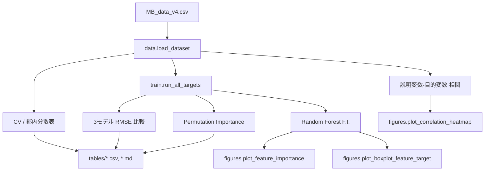

# MB_project — プログラム仕様書

本ドキュメントは `ex002_figure_set`（論文用 Figure Set 生成パイプライン）と `ex003_feature_engineering`（組み合わせ特徴量による UFB 濃度の寄与因子探索）の仕様を説明する．

---

# ex002_figure_set

---

## 1. 概要

`MB_data_v4.csv` を入力とし，論文執筆用の Figure Set（相関ヒートマップ，統計表，モデル比較表，F.I. 棒グラフ，散布図，置換重要度表）を生成する．

---

## 2. ディレクトリ構成

```text
ex002_figure_set/
├── data.py          # データ読み込み，CV/相関計算
├── figures.py       # モノクロ図の描画
├── train.py         # モデル学習・評価・Permutation Importance
├── run_figures.py   # 全 Figure/Table 生成のエントリポイント
└── train.ipynb      # Jupyter から run_figures.main() を実行

outputs/ex002_figure_set/
├── figures/         # PNG 図
├── tables/          # CSV / Markdown 表
└── manifest.json    # 生成メタデータ
```

---

## 3. 処理フロー



---

## 4. モジュール仕様

### 4.1 `data.py`

| 関数 | 概要 | 戻り値 |
| :--- | :--- | :--- |
| `load_dataset` | CSV 読み込み | `inputs (n,6)`, `targets (n,6)` |
| `build_groups` | 同一条件グループ ID | `groups (n,)` |
| `compute_cv_and_within_group_std` | CV（$\sigma/\mu$）と郡内標準偏差（標準化後） | `DataFrame` |
| `compute_input_target_correlation` | 説明変数×目的変数の Pearson $r$ | `DataFrame (6×3)` |
| `get_selected_targets` | MB, UFB, Oxygen を抽出 | `targets (n,3)` |

### 4.2 `figures.py`

| 関数 | 概要 |
| :--- | :--- |
| `apply_figure_style` | モノクロ，タイトルなし，最小スパイン |
| `plot_correlation_heatmap` | 相関係数ヒートマップ（カラー: 赤 1.0, 白 0, 青 -1.0） |
| `plot_feature_importance` | F.I. 水平棒グラフ（横軸上限指定可） |
| `plot_boxplot_feature_target` | 特徴量水準別 Box-Plot |
| `save_table_markdown` | Markdown 表保存 |

### 4.3 `train.py`

| 関数 | 概要 |
| :--- | :--- |
| `evaluate_models` | 線形/多項式/RF の GroupKFold RMSE |
| `compute_feature_importance` | RF F.I. fold 平均 |
| `compute_permutation_importance` | 置換重要度 fold 平均 |
| `run_all_targets` | 3 目的変数の一括実行 |

---

## 5. 実行方法

```bash
source .venv_mb/bin/activate
cd ex002_figure_set
python run_figures.py
```

または `train.ipynb` を実行する．

---

## 6. 出力ファイル

### figures/

| ファイル | 内容 |
| :--- | :--- |
| `correlation_input_target.png` | 説明変数×目的変数 相関 |
| `feature_importance_mb_concentration_particles_ml.png` | MB F.I. |
| `feature_importance_ufb_concentration_x10^7_particles_ml.png` | UFB F.I. |
| `feature_importance_oxygen_content_mg_l.png` | Oxygen F.I. |
| `boxplot_*.png` | 最重要特徴量の Box-Plot |

### tables/

| ファイル | 内容 |
| :--- | :--- |
| `cv_within_group.md` | CV・郡内標準偏差 |
| `model_comparison.md` | 3 モデル RMSE |
| `permutation_importance_all.md` | 全目的変数の置換重要度 |
| `input_target_correlation.md` | 相関係数 |

---

## 7. 表記規則

- データセット中の NB 表記は UFB に統一
- 図の軸ラベルは英語，単位付き（相関ヒートマップと F.I. 図は例外，7.1 参照）
- 評価 RMSE は標準化後スケール

### 7.1 相関ヒートマップ・F.I. 図の軸表記（例外）

- `correlation_input_target.png` の横軸（目的変数）は `MB conc.` / `UFB conc.` / `Oxygen cont.` の短縮表記とし，縦軸（説明変数）・横軸ともに単位を付けない．表示用のラベル変換は `run_figures.py` の `_build_correlation_display_df` / `_strip_unit` / `CORRELATION_TARGET_SHORT_LABELS` で行い，`tables/input_target_correlation.*` の値・ラベルは変更しない．
- `feature_importance_*.png` は縦軸ラベルを付けず，横軸を 0〜100 の範囲とし，軸ラベルを `Feature Importance [%]` とする（`figures.py` の `plot_feature_importance` で重要度を 100 倍して描画）．

---

# ex003_feature_engineering

## 1. 概要

`ex002_figure_set` の分析で，UFB concentration のみ単一の説明変数に支配されない（Feature Importance が分散する）ことが分かった．
本実験では，6 つの基礎説明変数から積・逆数・比による組み合わせ特徴量を新たに生成し，UFB concentration の予測・説明に寄与する特徴量を探索する．
モデル構造（Random Forest 等）自体は ex002 から変更しない．

## 2. ディレクトリ構成

```text
ex003_feature_engineering/
├── data.py             # データ読み込み，組み合わせ特徴量（積・逆数・比）の生成
├── train.py            # ex002_figure_set/train.py と同一（モデル学習・評価・重要度計算）
├── figures.py          # 上位重要度の棒グラフ・散布図の描画
└── run_experiment.py   # 実験のエントリポイント

outputs/ex003_feature_engineering/
├── figures/     # PNG 図
├── tables/      # CSV / Markdown 表
└── manifest.json
```

## 3. 組み合わせ特徴量

基礎説明変数はすべて正の値のみを取るため，逆数・比の計算で 0 除算は発生しない．`data.build_engineered_features` が以下を生成する．

| 種別 | 内容 | 個数 |
| :--- | :--- | :--- |
| base | 基礎説明変数そのもの | 6 |
| product | 相異なる 2 変数の積 $x_i \times x_j$（$i<j$） | 15 |
| reciprocal | 各変数の逆数 $1/x_i$ | 6 |
| ratio | 相異なる 2 変数の有向な比 $x_i/x_j$（$i \neq j$） | 30 |

合計 57 列の説明変数行列を構築し，UFB concentration（teacher_signals インデックス 2）に対する Random Forest の Feature Importance（MDI）と Permutation Importance を，基礎説明変数 6 列のみのベースラインと比較する．

## 4. 実行方法

```bash
source .venv_mb/bin/activate
cd ex003_feature_engineering
python run_experiment.py
```

## 5. 出力ファイル

### figures/

| ファイル | 内容 |
| :--- | :--- |
| `feature_importance_mdi_top15.png` | 拡張特徴量（57 列）の Feature Importance（MDI）上位 15 |
| `permutation_importance_top15.png` | 同 Permutation Importance 上位 15 |
| `scatter_top_engineered_feature.png` | 最も寄与が大きい組み合わせ特徴量 vs UFB concentration の散布図 |

### tables/

| ファイル | 内容 |
| :--- | :--- |
| `rmse_comparison.md` | ベースライン（6 特徴量）と拡張（57 特徴量）の Train/Test RMSE 比較 |
| `feature_importance_mdi.md` | 全 57 特徴量の Feature Importance（MDI，種別付き） |
| `permutation_importance.md` | 全 57 特徴量の Permutation Importance（種別付き） |

## 6. 表記規則

- `train.py` は `ex002_figure_set/train.py` と同一内容（コピー）であり，引数 `inputs` は任意の特徴量行列を受け付ける汎用実装のため変更していない．
- `evaluate_models` / `compute_feature_importance` / `compute_permutation_importance` は標準化済み目的変数を引数に取る仕様のため，`run_experiment.py` 内で `(targets - targets.mean(axis=0)) / targets.std(axis=0)` により標準化してから渡している．

---

## 7. `run_feature_selection.py`（相関に基づく貪欲法による特徴選択）

`run_experiment.py` で算出した 57 特徴量モデルの Permutation Importance 順位を候補順とし，既選択特徴量と Pearson 相関 $|r|>0.8$ の候補を冗長として除外する貪欲法（greedy）で，UFB concentration の Test RMSE を最小化する特徴量の組み合わせを探索する．モデル・交差検証・特徴量生成は `run_experiment.py` と同一であり，新規に導入したのは特徴選択の手続きのみである．

### 7.1 実行方法

```bash
source .venv_mb/bin/activate
cd ex003_feature_engineering
python run_experiment.py          # run_feature_selection.py が参照する関数・定数を定義
python run_feature_selection.py
```

### 7.2 出力ファイル

#### figures/

| ファイル | 内容 |
| :--- | :--- |
| `feature_selection_rmse_curve.png` | 選択特徴量数ごとの Train/Test RMSE の推移（ベースライン水平線付き） |
| `best_subset_feature_importance.png` | Test RMSE 最小の部分集合における Feature Importance（MDI） |
| `scatter_rmse_drop_feature.png` | Test RMSE が大きく低下した時点で追加された特徴量 vs UFB concentration の散布図 |

#### tables/

| ファイル | 内容 |
| :--- | :--- |
| `feature_selection_progression.md` | 貪欲法で特徴量を 1 つずつ追加した際の Train/Test RMSE の推移 |
| `feature_selection_skipped.md` | 相関冗長のため選択から除外された特徴量とその理由 |
| `best_subset_feature_importance.md` | Test RMSE 最小の部分集合における Feature Importance（MDI） |

`outputs/ex003_feature_engineering/manifest_feature_selection.json` に，閾値・選択特徴量数・最良 Test RMSE 等の実行条件と結果の要約を記録する．

---

## 8. `run_exhaustive_search.py`（上位候補に限定した厳密な全部分集合探索）

貪欲法（7 章）は相関閾値による逐次的な候補除外を行うため，真に最良な組み合わせを見落とす可能性がある．
本スクリプトは，57 特徴量モデルの Permutation Importance 上位 `CANDIDATE_POOL_SIZE`（既定 15）件に候補を絞った上で，サイズ 1〜`MAX_SUBSET_SIZE`（既定 5）の部分集合を**全て**評価し，Test RMSE を最小化する組み合わせを求める．
探索フェーズでは決定木数を `SEARCH_N_ESTIMATORS`（既定 30）に減らして計算量を抑え，各サイズの最良部分集合のみ `RF_N_ESTIMATORS`（100，`train.py` と同一）で再評価して最終的な Test RMSE とする．
モデル・交差検証・特徴量生成は `run_experiment.py` と同一であり，新規に導入したのは全探索の手続きのみである．

### 8.1 実行方法

```bash
source .venv_mb/bin/activate
cd ex003_feature_engineering
python run_experiment.py           # 依存する関数・定数を定義
python run_exhaustive_search.py    # 候補 15 件 × サイズ 1〜5 の全探索（約 10 分）
```

### 8.2 出力ファイル

#### figures/

| ファイル | 内容 |
| :--- | :--- |
| `exhaustive_search_rmse_curve.png` | 各サイズの最良部分集合における Train/Test RMSE（n_estimators=100 で再評価，ベースライン水平線付き） |
| `exhaustive_search_best_feature_importance.png` | 全探索で見つかった最良部分集合の Feature Importance（MDI） |

#### tables/

| ファイル | 内容 |
| :--- | :--- |
| `exhaustive_search_top50.md` | 探索した全部分集合のうち Test RMSE（探索時，n_estimators=30）上位 50 |
| `exhaustive_search_best_per_size.md` | サイズ 1〜5 ごとの最良部分集合と，n_estimators=100 による再評価後の Train/Test RMSE |
| `exhaustive_search_best_feature_importance.md` | 全探索で見つかった最良部分集合の Feature Importance（MDI） |

`outputs/ex003_feature_engineering/manifest_exhaustive_search.json` に，候補プール・探索件数・所要時間・最良部分集合等を記録する．
